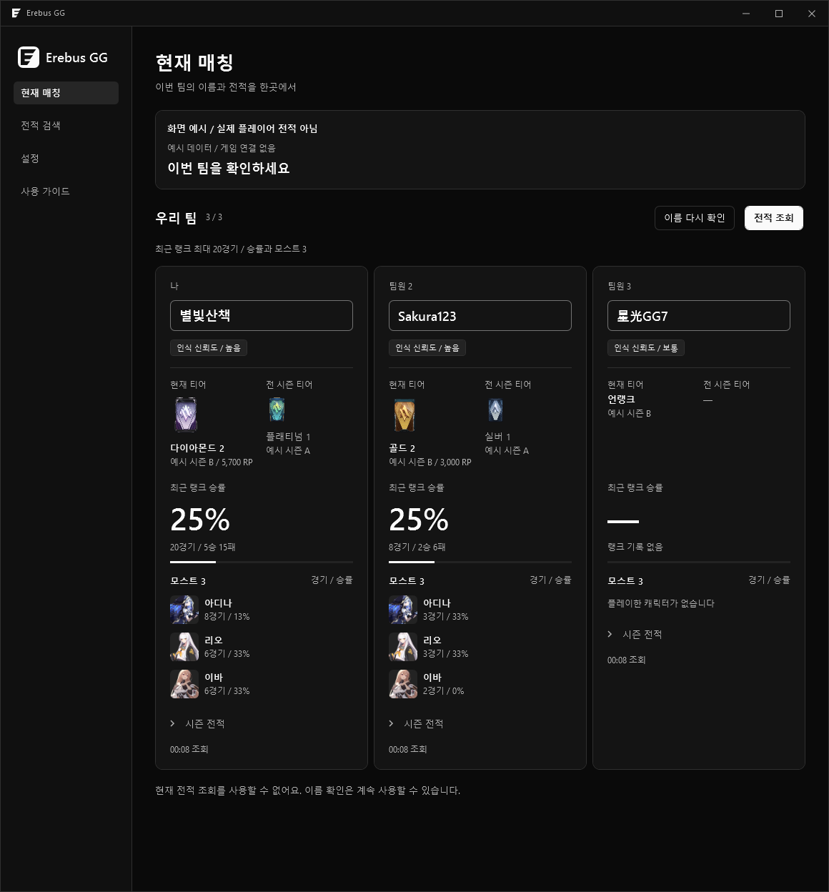
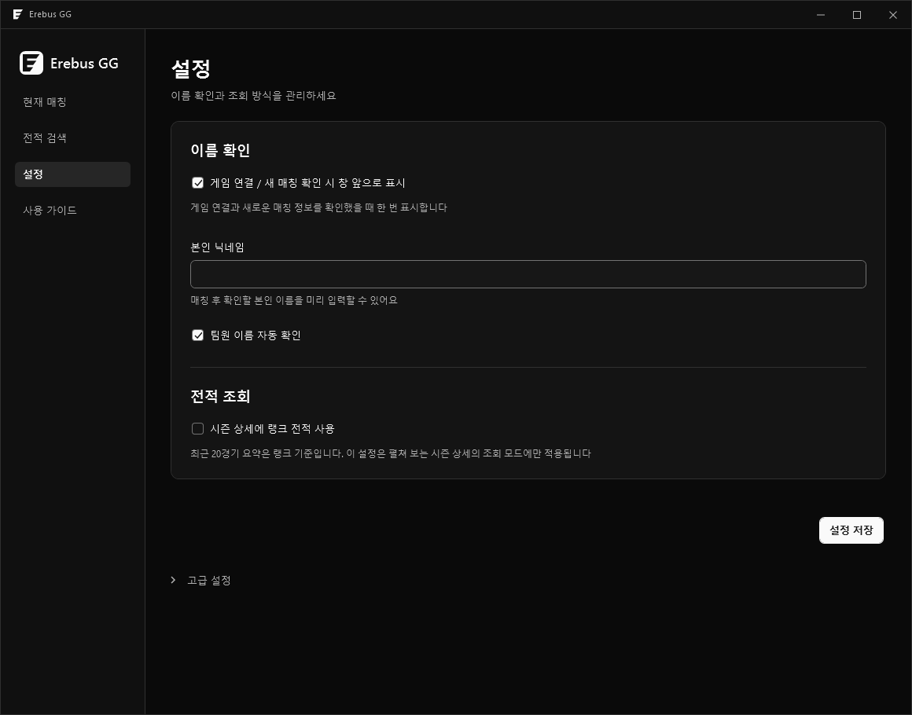

<p align="center"></p>
<p align="center">이터널 리턴 팀원 이름과 전적 확인 도우미</p>
<p align="center">v0.0.1 / Windows 10, 11 x64</p>
<p align="center"><a href="https://github.com/eulovehan/ErebusGG/releases/latest/download/ErebusGG-Setup-0.0.1.exe"><strong>Windows 설치 EXE 다운로드</strong></a> / <a href="https://github.com/eulovehan/ErebusGG/releases">전체 다운로드</a></p>

> 현재는 이름 자동 확인과 직접 수정을 사용할 수 있습니다. 공개 전적 조회 서비스와 실제 티어 조회는 준비 중입니다. 아래 전적과 티어는 화면 설명을 위한 예시입니다.



## 시작하기

**[ErebusGG-Setup-0.0.1.exe 다운로드](https://github.com/eulovehan/ErebusGG/releases/download/v0.0.1/ErebusGG-Setup-0.0.1.exe)** → 설치 파일 실행 → 시작 메뉴에서 **Erebus GG** 실행

설치는 현재 Windows 사용자에게만 적용됩니다. 삭제는 Windows 설정의 설치된 앱에서 할 수 있습니다. 실행 오류가 나면 [Microsoft Visual C++ x64 런타임](https://aka.ms/vs/17/release/vc_redist.x64.exe)을 설치해 주세요.

| 순서 | 사용 방법 |
|---|---|
| 1. 준비 | 앱을 열고 설정에서 본인 닉네임을 입력한 뒤 저장 |
| 2. 매칭 | 게임의 캐릭터 / 루트 선택 화면을 전경에 유지 |
| 3. 확인 | 현재 매칭에서 이름 확인, 잘못 읽힌 이름은 입력창에서 직접 수정 |



이름이 누락되면 **이름 다시 확인**, 처음 읽힌 이름이 불확실하면 **이 이름이 맞아요**를 눌러 주세요. 인식 신뢰도는 낮음 / 보통 / 높음으로 표시됩니다. 직접 수정한 이름은 자동 인식으로 덮어쓰지 않습니다.

## 화면에서 확인할 정보

**닉네임 → 현재 / 전 시즌 티어 → 최근 랭크 최대 20경기 승률 → 모스트 3** 순서로 배치했습니다. 전적 조회가 연결되기 전에는 실제 수치를 표시하지 않습니다. 미조회 대시와 랭크 기록 없음은 서로 다른 상태입니다.

| 단축키 | 동작 |
|---|---|
| Ctrl + R | 이름 다시 확인 |
| Ctrl + Enter | 전적 조회 |
| Ctrl + , | 설정 열기 |
| Esc | 현재 매칭으로 돌아가기 |

<details>
<summary>직접 빌드해서 실행하기</summary>

저장소를 받은 뒤 Windows PowerShell에서 실행합니다.

```powershell
.\bootstrap.ps1
.\build.ps1 -Test -Publish
.\artifacts\erebusgg-win-x64\ErebusGG.exe
```

Visual Studio에서는 ErebusGG.sln을 엽니다. VS Code에서는 open-vscode.cmd를 사용할 수 있습니다. 네이티브 인식 라이브러리 실행에는 Visual C++ x64 런타임이 필요할 수 있습니다.

</details>

실행과 화면 검증은 Windows 11에서 진행했습니다. Windows 10 실기와 실제 전적 API 연결 검증은 남아 있습니다. 이름 인식은 한국어 UI, 1920 × 1080을 기준으로 하며 화면 배율과 게임 UI에 따라 직접 수정이 필요할 수 있습니다.

Erebus GG는 비공식 도우미입니다. 게임 및 이미지 권리는 원 권리자에게 있습니다. [라이선스와 이미지 출처](THIRD-PARTY-NOTICES.md)
